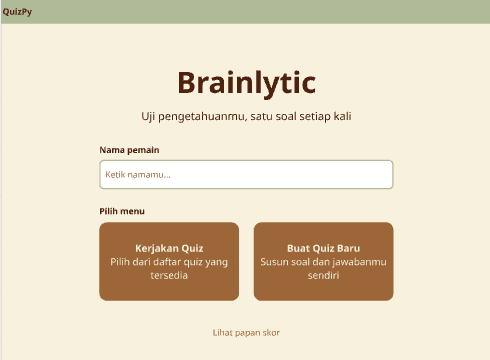
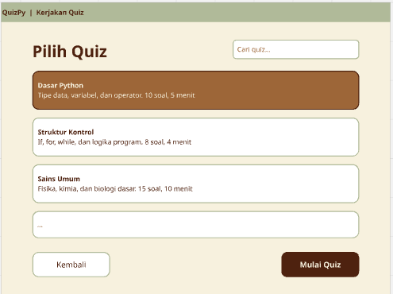
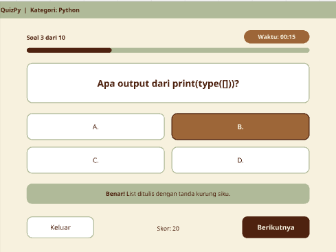
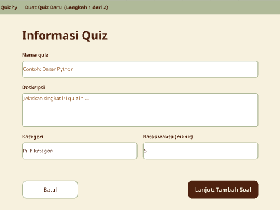

<!--
TEMPLATE README — Final Project Pemrograman Komputer (IS1113)
Cara memakai:
1. Salin file ini ke folder utama proyek kalian dan ganti namanya menjadi README.md.
2. Ganti semua teks dalam [kurung siku]. Hapus komentar petunjuk seperti ini sebelum dikumpulkan.
3. Simpan screenshot di folder screenshots/ dengan nama yang sama seperti di bawah,
   atau ubah nama file di tautan gambar supaya cocok.
4. Pratinjau README di VS Code: buka file ini lalu tekan Ctrl+Shift+V (Windows) / Cmd+Shift+V (macOS).
-->

&nbsp;

# Brainlytic

An interactive desktop quiz application developed using Python and Tkinter. Users can answer multiple-choice questions, receive feedback, track their scores, and view their final results. Users can also export Quiz to a text file



## Anggota Kelompok \[N\]

| No | Nama | NIM | Peran | File / fungsi yang ditulis |
| :---- | :---- | :---- | :---- | :---- |
| 1 | James Elisha Hamonangan Tambanie Supit | 105022610045 | Ketua | \[main.py: …\] |
| 2 | Bastian Jansen Tangkuman | 105022610082 | Programmer GUI | \[main.py: tampilkan\_daftar(), …\] |
| 3 | Viola Keni | 105012610069 | Programmer logika | \[logika.py: hitung\_total(), …\] |
| 4 | Riwan Rikardo | 105032310004 | Programmer data/file | \[penyimpanan.py: simpan\_data(), muat\_data()\] |
| 5 | Hillary Maindoka | 105012610083 | Penguji & dokumentasi | \[skenario uji, README, slide\] |

## Latar Belakang

- **Masalah:** Beberapa siswa/mahasiswa membutuhkan aplikasi pembuat quiz lokal yang intuitif dan mudah digunakan tanpa internet. 
- **Pengguna sasaran:**  Siswa/mahasiswa, dari tingkat pendidikan mana pun, yang mampu mengoperasikan komputer
- **Tujuan:** Membangun aplikasi quiz interaktif dengan desain yang intuitif dan sederhana yang siap digunakan langsung.

## Fitur Utama

| No | Fitur | Input | Output |
| :---- | :---- | :---- | :---- |
| 1 | Pemilihan Quiz | Quiz yang dipilih | Membuka halaman Pengerjaan Quiz |
| 2 | Pengerjaan Quiz | Pengguna menentukan pilihan jawaban di setiap pertanyaan dari Quiz yang dipilih | Progress pengerjaan Quiz dan Timer tiap pertanya |
| 3 | Screen Hasil Quiz | \[ \] | \[ \] |
| 4 | Papan Peringkat | \[ \] | \[ \] |

## Screenshot

<!-- Minimal satu screenshot untuk setiap fitur utama, ditambah pesan validasi dan isi file data. -->

&nbsp;

**Fitur 1 — Pemilihan Quiz**



**Fitur 2 — Pengerjaan Quiz**



**Fitur 3 — Screen Hasil Quiz**


**Fitur 4 — Pembuatan Quiz**



**Pesan validasi saat input salah**


**Isi file data setelah disimpan**


## Kebutuhan Sistem

- Python \[3.x\] (diuji di Python \[versi\])  
- tkinter (sudah terpasang bersama Python)  
- Sistem operasi yang sudah diuji: \[Windows 11 / macOS / Linux\]  
- Pustaka tambahan: \[tidak ada / nama pustaka, jika disetujui dosen\]

## Cara Menjalankan

1. Unduh atau ekstrak folder `[NamaAplikasi_KelompokN]`.

2. Buka terminal atau Command Prompt di folder tersebut.

3. Jalankan perintah:

```sh
python main.py
```

   Di macOS atau Linux, gunakan `python3 main.py` jika perintah `python` tidak dikenali.

4. \[Langkah tambahan jika ada, misalnya akun contoh untuk login\]

## Cara Penggunaan

1. \[Langkah 1, misalnya: isi nama barang dan harga, lalu klik **Tambah**\]  
2. \[Langkah 2\]  
3. \[Langkah 3\]  
4. \[Langkah 4\]

## Struktur Folder

```
[NamaAplikasi_KelompokN]/
├── main.py            # [titik masuk aplikasi dan tampilan]
├── logika.py          # [perhitungan, validasi, pengolahan koleksi]
├── penyimpanan.py     # [baca/tulis file data]
├── data/
│   └── [data.txt]     # [file data]
├── screenshots/
└── README.md
```

## Daftar Fungsi

| File | Fungsi | Parameter | Return | Kegunaan |
| :---- | :---- | :---- | :---- | :---- |
| \[logika.py\] | \[hitung\_total\] | \[keranjang: list\] | \[int\] | \[menjumlahkan harga × jumlah semua item\] |
| \[ \] | \[ \] | \[ \] | \[ \] | \[ \] |
| \[ \] | \[ \] | \[ \] | \[ \] | \[ \] |
| \[ \] | \[ \] | \[ \] | \[ \] | \[ \] |
| \[ \] | \[ \] | \[ \] | \[ \] | \[ \] |

## Format File Data

File `[data/data.txt]` menyimpan satu data per baris dengan pemisah `[;]`:

```
[nama;harga;jumlah]
[Nasi Goreng;15000;2]
```

## Penerapan Materi

<!-- Tunjukkan di mana setiap materi dipakai. Bagian ini dinilai (README R6) dan menjadi dasar tanya jawab. -->

&nbsp;

| Materi | Di mana dipakai (file → fungsi) | Contoh singkat |
| :---- | :---- | :---- |
| Variabel, tipe data, ekspresi, operator | \[main.py → tombol\_tambah()\] | \[`harga = int(entry_harga.get())`\] |
| Percabangan (if, elif, else) | \[logika.py → validasi\_input()\] | \[`if teks == "" or not teks.isdigit():`\] |
| Perulangan (for, while) | \[logika.py → hitung\_total()\] | \[`for item in keranjang:`\] |
| Struktur data koleksi | \[ \] | \[list of dict untuk …, tuple untuk …\] |
| Fungsi & modul | \[ \] | \[`import logika`\] |
| Input/output & file | \[penyimpanan.py → simpan\_data()\] | \[`open(nama_file, "w")`\] |

## Skenario Uji

<!-- Minimal 10 kasus: input normal, input salah, dan kasus batas. -->

&nbsp;

| No | Skenario | Input | Hasil yang diharapkan | Hasil aktual | Status |
| :---- | :---- | :---- | :---- | :---- | :---- |
| 1 | \[Menambah data dengan input benar\] | \[nama=Buku, harga=15000\] | \[Data tampil di daftar, total bertambah\] | \[ \] | \[Lulus/Gagal\] |
| 2 | \[Harga diisi huruf\] | \[harga=abc\] | \[Muncul pesan error, data tidak ditambah\] | \[ \] | \[ \] |
| 3 | \[Input kosong\] | \[ \] | \[ \] | \[ \] | \[ \] |
| 4 | \[File data belum ada\] | \[ \] | \[Aplikasi tetap terbuka dengan daftar kosong\] | \[ \] | \[ \] |
| 5 | \[ \] | \[ \] | \[ \] | \[ \] | \[ \] |
| 6 | \[ \] | \[ \] | \[ \] | \[ \] | \[ \] |
| 7 | \[ \] | \[ \] | \[ \] | \[ \] | \[ \] |
| 8 | \[ \] | \[ \] | \[ \] | \[ \] | \[ \] |
| 9 | \[ \] | \[ \] | \[ \] | \[ \] | \[ \] |
| 10 | \[ \] | \[ \] | \[ \] | \[ \] | \[ \] |

## Kendala dan Pengembangan

- **Kendala dan solusinya:** \[ \]  
- **Pengembangan berikutnya:** \[ \]

## Penggunaan AI dan Referensi

<!-- Wajib diisi dengan jujur. Lihat Bagian 9 panduan. -->

&nbsp;

- **Penggunaan AI:** \[Tidak memakai AI / Memakai (nama alat) untuk … , oleh (nama anggota)\]  
- **Referensi:** \[materi kuliah, dokumentasi Python/tkinter, tutorial, atau forum yang dipakai\]

---

Final Project Pemrograman Komputer (IS1113) · Universitas Klabat · November 2026
